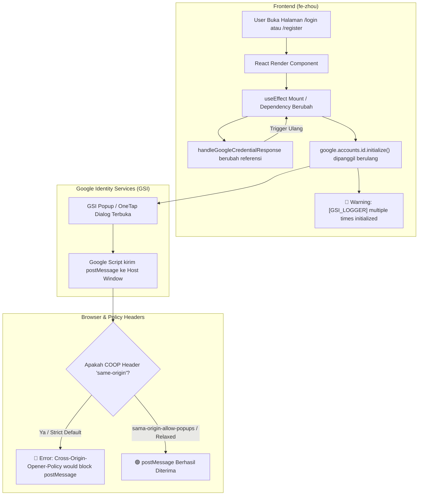

# 📋 LAPORAN TEKNIS PM: KENDALA GOOGLE OAUTH & GSI (COOP & MULTIPLE INITIALIZATION)

**Proyek:** Zhou Consulting Platform  
**Disusun Oleh:** Project Manager (Technical Investigation & Incident Report)  
**Tanggal:** 26 Oktober 2026  
**Klasifikasi:** Bug / Warning Investigasi & Solusi Refactoring  
**Prioritas:** 🟡 Medium - High (Mempengaruhi reliabilitas autentikasi Google SSO dan performa render client)  
**Target Tim:** Frontend Developer (`fe-zhou`) & Backend/DevOps Developer (`be-zhou`)  

---

## 1. Ringkasan Eksekutif & Log Error Lapangan

Pada konsol peramban (*browser console*) saat mengakses alur autentikasi (Login dan Registrasi), terdeteksi kemunculan pesan error dan warning berulang terkait **Google Identity Services (GSI)** dan **Cross-Origin-Opener-Policy (COOP)**:

```text
client:394 Cross-Origin-Opener-Policy policy would block the window.postMessage call.
iv @ client:394
(anonymous) @ client:355
bg @ client:130
b @ client:127

client:87 [GSI_LOGGER]: google.accounts.id.initialize() is called multiple times. 
This could cause unexpected behavior and only the last initialized instance will be used.
_.G @ client:87
nt @ client:307
r @ page-cefefe529ddb2d60.js:1
...
```

### Rekapitulasi Temuan:
1. **Error 1 (COOP Block postMessage):** Terjadi ketika skrip Google Identity Services (`client:394`) mencoba mengirimkan data kredensial/status antara *popup* atau *iframe* autentikasi Google (`accounts.google.com`) dengan jendela utama aplikasi (*opener window*) melalui `window.postMessage`, namun dibatasi oleh kebijakan isolasi origin browser.
2. **Warning 2 (GSI Multiple Initialization):** Terjadi pemanggilan `google.accounts.id.initialize()` secara berulang-ulang pada siklus hidup komponen React di halaman Login (`/login`) dan Registrasi (`/register`), memicu risiko *callback drop* dan instabilitas sesi autentikasi.

---

## 2. Analisis Mendalam Akar Masalah (Root Causes)



---

### 🔍 Masalah 1: `google.accounts.id.initialize()` Dipanggil Berkali-kali (FE Issue)

* **Lokasi Berkas Terdampak:**
  * `fe-zhou/src/app/login/page.tsx` (Baris 110–144)
  * `fe-zhou/src/app/register/page.tsx` (Baris 175–209)

#### Penyebab Teknis:
Pada implementasi saat ini:
```typescript
// fe-zhou/src/app/login/page.tsx
const handleGoogleCredentialResponse = useCallback(
  async (response: any) => { /* ... */ },
  [login, redirectParam, router] // Dependencies sering berubah / dirender ulang
);

useEffect(() => {
  const initGoogle = () => {
    if (typeof window === "undefined" || !window.google?.accounts?.id) return;
    
    // ⚠️ Masalah: Dijalankan setiap kali handleGoogleCredentialResponse berubah
    // dan tidak ada flag penanda apakah GSI sudah pernah diinisialisasi
    window.google.accounts.id.initialize({
      client_id: clientId,
      callback: handleGoogleCredentialResponse,
      cancel_on_tap_outside: true,
    });

    if (googleBtnRef.current) {
      window.google.accounts.id.renderButton(googleBtnRef.current, { /* ... */ });
    }
  };

  // ... setInterval polling ...
}, [handleGoogleCredentialResponse]); // ⚠️ Dependency menyebabkan useEffect re-run berulang kali!
```

1. **Instabilitas Dependency `useEffect`:** `handleGoogleCredentialResponse` bergantung pada `[login, redirectParam, router]`. Saat konteks autentikasi atau router Next.js memperbarui statusnya, fungsi tersebut dibuat ulang.
2. **React Strict Mode:** Di lingkungan development, React me-mount komponen sebanyak dua kali (*mount -> unmount -> remount*), sehingga `initGoogle()` dijalankan minimal 2 kali.
3. **Ketiadaan Guard Ref:** Tidak ada pengecekan status inisialisasi (`useRef`), sehingga setiap re-render akan menimpa instans global Google SDK dengan peringatan dari GSI logger.

---

### 🔍 Masalah 2: `Cross-Origin-Opener-Policy would block postMessage` (FE / Infra Issue)

* **Lokasi Berkas / Konfigurasi Terdampak:**
  * `fe-zhou/next.config.mjs` (Header HTTP Next.js)
  * Konfigurasi Reverse Proxy / Nginx / Vercel (jika ada header kustom)
  * Mode `ux_mode` pada inisialisasi GSI

#### Penyebab Teknis:
1. **Kebijakan Isolasi Origin:** Secara default, browser modern menerapkan isolasi antar *browsing context group*. Ketika Google Sign-In membuka popup atau frame otentikasi di `accounts.google.com`, skrip Google (`https://accounts.google.com/gsi/client`) berusaha mengirimkan hasil otentikasi via `window.postMessage` ke `window.opener`.
2. **COOP Header Konflik:** Jika frontend atau environment menyematkan header `Cross-Origin-Opener-Policy: same-origin`, browser akan secara ketat memutus hubungan `window.opener` dengan domain eksternal (`accounts.google.com`), menyebabkan panggilan `postMessage` diblokir.
3. **Catatan Sifat Warning:** Pada beberapa versi Chrome, warning ini juga muncul secara internal dari skrip Google saat popup ditutup sebelum `postMessage` selesai dijawab. Namun, jika header COOP tidak dikonfigurasi dengan `same-origin-allow-popups`, otentikasi popup berisiko gagal menerima token.

---

## 3. Dampak Terhadap Aplikasi & Pengguna

| Aspek | Dampak | Tingkat Keparahan |
| :--- | :--- | :--- |
| **User Experience (Login Google)** | Pengguna berpotensi mengalami tombol login Google tidak responsif atau popup tertutup tanpa menyelesaikan sesi login karena callback tertimpa. | 🟡 Medium |
| **Konsistensi State FE** | Callback autentikasi lama tertimpa instans baru, menyebabkan *race condition* jika pengguna mengklik cepat. | 🟡 Medium |
| **Kebersihan Log Browser** | Konsol penuh dengan puluhan baris warning/error dari GSI dan COOP yang mengaburkan pesan error aplikasi sesungguhnya. | 🟢 Low |

---

## 4. Panduan Solusi & Rekomendasi Perbaikan untuk Developer

### A. Rekomendasi Perbaikan untuk Frontend Developer (`fe-zhou`)

#### 1. Gunakan Ref Guard & Stable Callback pada `login/page.tsx` & `register/page.tsx`
Hindari memasukkan fungsi callback yang berubah-ubah ke dalam dependency array `useEffect`. Gunakan `useRef` untuk menyimpan referensi callback terbaru dan flag `isInitializedRef`.

**Contoh Pola Perbaikan yang Direkomendasikan:**
```tsx
// 1. Buat ref untuk callback dan guard inisialisasi
const isGoogleInitialized = useRef(false);
const handleCredentialResponseRef = useRef(handleGoogleCredentialResponse);

// Selalu sinkronkan ref dengan fungsi callback terkini tanpa memicu re-run effect
useEffect(() => {
  handleCredentialResponseRef.current = handleGoogleCredentialResponse;
}, [handleGoogleCredentialResponse]);

useEffect(() => {
  let timer: NodeJS.Timeout | null = null;

  const initGoogle = () => {
    if (typeof window === "undefined" || !window.google?.accounts?.id) return;
    
    // ✅ Cegah inisialisasi ganda
    if (!isGoogleInitialized.current) {
      const clientId =
        process.env.NEXT_PUBLIC_GOOGLE_CLIENT_ID ||
        "437117810752-udkb6njkiujm5md6b5v1o145celqes9m.apps.googleusercontent.com";

      window.google.accounts.id.initialize({
        client_id: clientId,
        // ✅ Panggil callback via stable ref
        callback: (res: any) => handleCredentialResponseRef.current(res),
        cancel_on_tap_outside: true,
      });

      isGoogleInitialized.current = true;
    }

    // Render tombol jika kontainer tersedia
    if (googleBtnRef.current) {
      // Bersihkan kontainer sebelumnya bila perlu
      googleBtnRef.current.innerHTML = "";
      window.google.accounts.id.renderButton(googleBtnRef.current, {
        theme: "outline",
        size: "large",
        width: 380,
        text: "signin_with", // atau "signup_with" pada register
      });
    }
  };

  if (typeof window !== "undefined" && window.google?.accounts?.id) {
    initGoogle();
  } else {
    timer = setInterval(() => {
      if (typeof window !== "undefined" && window.google?.accounts?.id) {
        if (timer) clearInterval(timer);
        initGoogle();
      }
    }, 200);
  }

  return () => {
    if (timer) clearInterval(timer);
  };
}, []); // ✅ Dependency kosong []: hanya dijalankan sekali saat mount!
```

---

#### 2. Konfigurasi Header COOP di `fe-zhou/next.config.mjs`
Tambahkan konfigurasi header keamanan di Next.js agar mengizinkan popup Google OAuth berkomunikasi dengan window utama:

```javascript
/** @type {import('next').NextConfig} */
const nextConfig = {
  eslint: {
    ignoreDuringBuilds: true,
  },
  async headers() {
    return [
      {
        source: '/(.*)',
        headers: [
          {
            key: 'Cross-Origin-Opener-Policy',
            // ✅ Izinkan popup berkomunikasi dengan window pembuka (Google Auth)
            value: 'same-origin-allow-popups',
          },
        ],
      },
    ];
  },
};

export default nextConfig;
```

---

### B. Rekomendasi untuk Backend & DevOps Developer (`be-zhou`)

1. **Verifikasi Header Backend (`be-zhou/src/app.ts`):**
   * Backend saat ini sudah memiliki konfigurasi `crossOriginOpenerPolicy: false` di Helmet:
     ```typescript
     crossOriginOpenerPolicy: false,
     ```
   * Konfigurasi ini sudah tepat dan tidak perlu diubah, agar API backend tidak membatasi respons frontend.
2. **Verifikasi Nginx / Cloudflare (Production VPS):**
   * Pastikan reverse proxy (Nginx) tidak menyematkan header `Cross-Origin-Opener-Policy: same-origin` secara global yang dapat menimpa header Next.js.
   * Jika disetel di Nginx, gunakan:
     ```nginx
     add_header Cross-Origin-Opener-Policy "same-origin-allow-popups" always;
     ```

---

## 5. Checklist Verifikasi & QA (Kriteria Penerimaan)

Setelah perbaikan diimplementasikan oleh tim developer, QA dan developer wajib memvalidasi poin berikut:

- [ ] **Buka halaman `/login`:** Buka Developer Tools Console. Tidak ada lagi peringatan `[GSI_LOGGER]: google.accounts.id.initialize() is called multiple times`.
- [ ] **Buka halaman `/register`:** Verifikasi hal yang sama, `initialize()` hanya terpanggil tepat 1 kali.
- [ ] **Uji Interaksi Tombol Google:**
  - [ ] Klik tombol *Sign in with Google*.
  - [ ] Popup Google Account Chooser terbuka tanpa macet.
  - [ ] Pilih akun Google penguji.
  - [ ] Callback berhasil menerima ID Token dan diteruskan ke `POST /api/v1/auth/google`.
  - [ ] Pengguna diarahkan ke dashboard sesuai role tanpa error COOP blocking.
- [ ] **Uji Batal Login:** Tutup popup Google secara manual, pastikan konsol tidak melempar uncaught exception fatal.

---
*Laporan ini diterbitkan oleh Project Manager sebagai panduan tugas teknis (Action Item) untuk Frontend Developer dan Backend Developer Zhou Consulting.*
